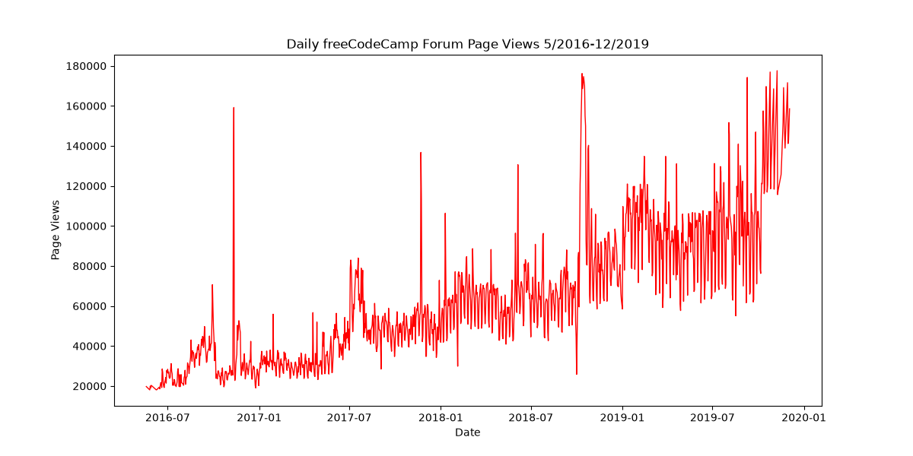
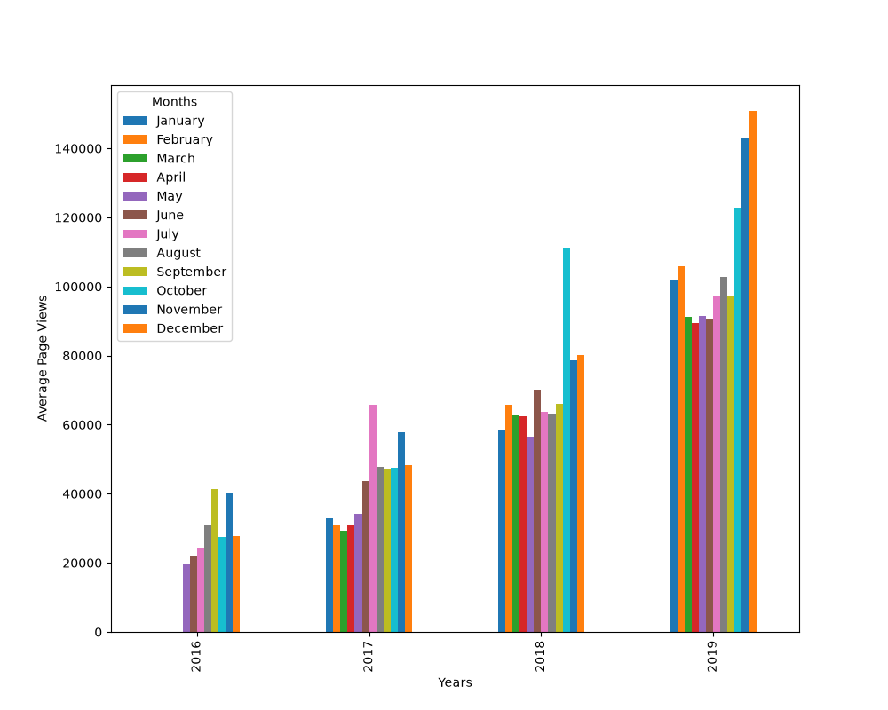
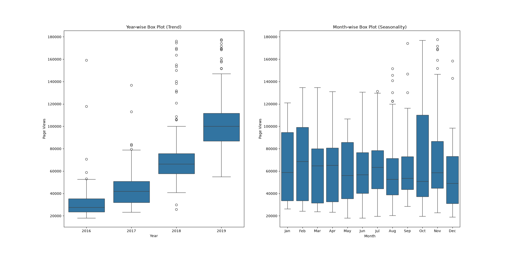

# Page View Time Series Visualizer

Solusi proyek freeCodeCamp *Data Analysis with Python* — Page View Time Series Visualizer.

## Deskripsi

Proyek ini memvisualisasikan data *time series* (deret waktu) dari jumlah kunjungan harian ke forum freeCodeCamp.org dari tanggal 9 Mei 2016 hingga 3 Desember 2019. Data dianalisis dan diplot menggunakan **Pandas**, **Matplotlib**, dan **Seaborn** untuk melihat pola kunjungan, tren tahunan, dan pertumbuhan bulanan.

## Fitur & Tugas

1. **Data Cleaning:** Menyaring data dengan membuang nilai ekstrem (di bawah persentil 2.5% dan di atas persentil 97.5%).
2. **Line Plot:** Grafik garis harian yang menunjukkan tren kunjungan dari waktu ke waktu.
3. **Bar Chart:** Grafik batang rata-rata kunjungan per bulan yang dikelompokkan berdasarkan tahun.
4. **Box Plots:** Dua grafik kotak berdampingan untuk melihat tren per tahun dan pola musiman (seasonality) per bulan.

## Hasil Visualisasi

### 1. Daily Page Views (Line Plot)


### 2. Monthly Average Page Views (Bar Chart)


### 3. Yearly & Monthly Distribution (Box Plot)


## Struktur Project

| File | Keterangan |
|------|-----------|
| `time_series_visualizer.py` | Kode utama untuk data cleaning dan pembuatan grafik |
| `main.py` | Entry point untuk membuat grafik dan menjalankan unit test |
| `test_module.py` | Unit test dari freeCodeCamp |
| `fcc-forum-pageviews.csv` | Dataset kunjungan forum |
| `requirements.txt` | Dependensi (`pandas`, `seaborn`, `matplotlib`) |

## Cara Menjalankan

```bash
# Install dependensi
pip install -r requirements.txt

# Jalankan program
python main.py
```

## Hasil Test

```text
Ran 11 tests in 7.332s

OK
```
